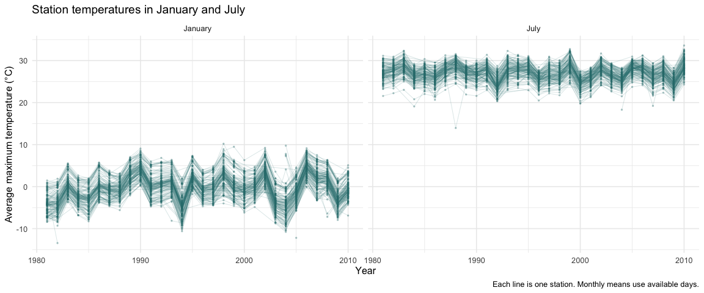
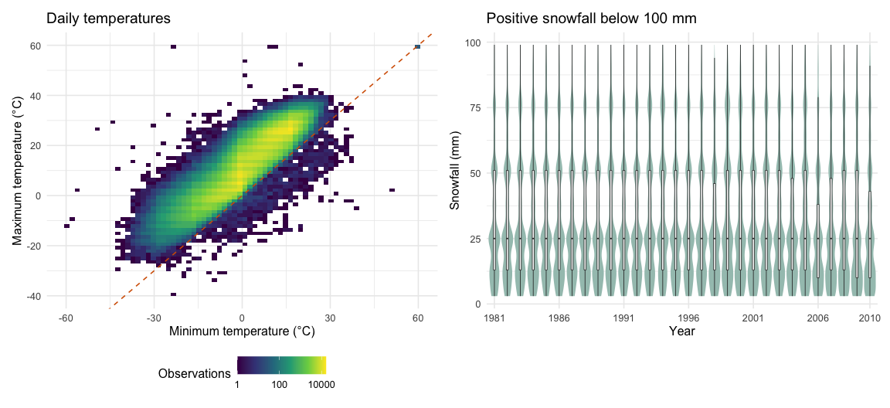
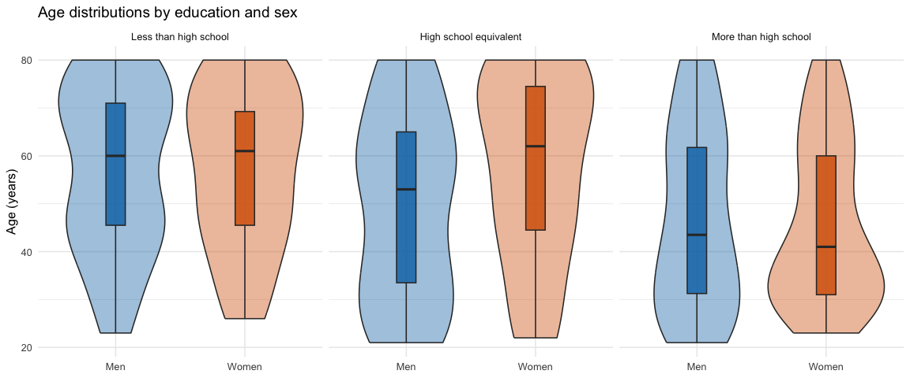
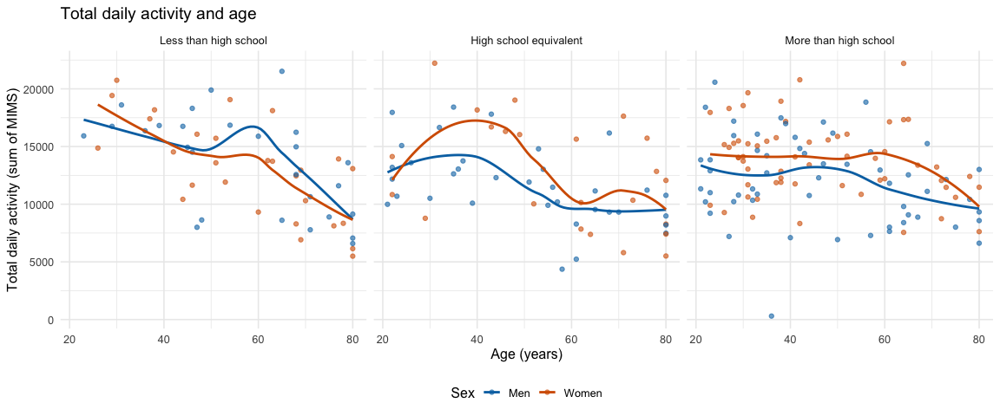
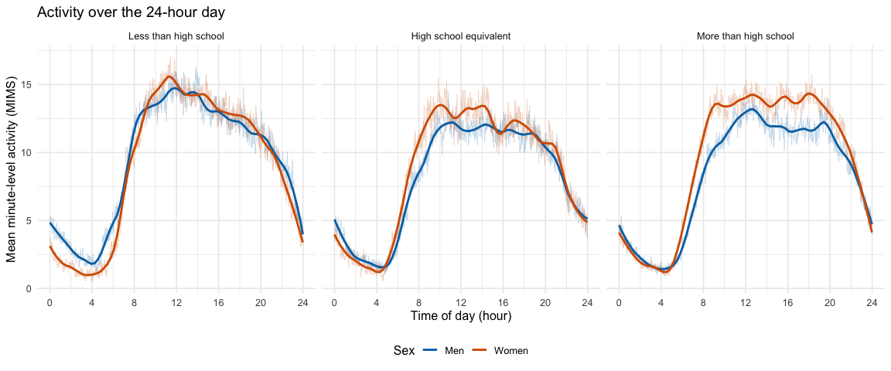

P8105 Homework 3
================
Ziyang Tian (zt2426)

## Problem 0

I use one R Markdown file for this homework. The local data files are in
the `data` folder, and I use relative paths to read them. I load the
NOAA data from the `p8105.datasets` package. The R Markdown file uses
`github_document` output.

## Problem 1

### Data description and missing values

``` r
data("ny_noaa")
```

The dataset has 2,595,176 observations and 7 variables. Each row is one
daily record from a weather station. There are 747 stations in New York
State, and the dates range from 1981-01-01 to 2010-12-31.

The variables are station ID (`id`), date (`date`), precipitation
(`prcp`), snowfall (`snow`), snow depth (`snwd`), maximum temperature
(`tmax`), and minimum temperature (`tmin`). The original precipitation
unit is tenths of a millimeter. The original temperature unit is tenths
of a degree Celsius. Snowfall and snow depth are already in millimeters,
according to the [course data
description](https://p8105.com/dataset_noaa.html).

``` r
missing_summary <- ny_noaa %>%
  summarise(across(everything(), ~ sum(is.na(.x)))) %>%
  pivot_longer(
    everything(),
    names_to = "variable",
    values_to = "missing"
  ) %>%
  mutate(percent = 100 * missing / nrow(ny_noaa))

knitr::kable(
  missing_summary,
  digits = 3,
  col.names = c("Variable", "Missing observations", "Missing (%)")
)
```

| Variable | Missing observations | Missing (%) |
|:---------|---------------------:|------------:|
| id       |                    0 |       0.000 |
| date     |                    0 |       0.000 |
| prcp     |               145838 |       5.620 |
| snow     |               381221 |      14.690 |
| snwd     |               591786 |      22.803 |
| tmax     |              1134358 |      43.710 |
| tmin     |              1134420 |      43.713 |

Missing data are a major issue. Maximum and minimum temperatures are
missing for about 43.710% and 43.713% of the records. Some stations
report only a subset of the weather variables. Missing values may affect
comparisons across stations and years.

### Data cleaning and common snowfall values

``` r
noaa_df <- ny_noaa %>%
  mutate(
    year = lubridate::year(date),
    month = lubridate::month(date),
    day = lubridate::day(date),
    tmax = as.numeric(tmax) / 10,
    tmin = as.numeric(tmin) / 10,
    prcp = prcp / 10
  )
```

I keep the original date and add separate year, month, and day
variables. I convert maximum and minimum temperatures to numeric values
in degrees Celsius, and precipitation to millimeters. Snowfall and snow
depth remain in millimeters. The cleaned dataset has 10 variables.

``` r
snow_counts <- noaa_df %>%
  filter(!is.na(snow)) %>%
  count(snow, sort = TRUE) %>%
  slice_head(n = 6)

knitr::kable(
  snow_counts,
  col.names = c("Snowfall (mm)", "Number of observations")
)
```

| Snowfall (mm) | Number of observations |
|--------------:|-----------------------:|
|             0 |                2008508 |
|            25 |                  31022 |
|            13 |                  23095 |
|            51 |                  18274 |
|            76 |                  10173 |
|             8 |                   9962 |

The most common snowfall value is 0 mm, with 2,008,508 observations.
This is reasonable because many days have no snowfall. Other common
values include 25, 13, 51, and 76 mm. These values are close to
whole-inch or half-inch amounts, so rounding or conversion from inches
may explain the pattern.

### Average maximum temperature in January and July

``` r
station_month_df <- noaa_df %>%
  filter(month %in% c(1, 7)) %>%
  group_by(id, year, month) %>%
  summarise(
    mean_tmax = mean(tmax, na.rm = TRUE),
    observed_days = sum(!is.na(tmax)),
    .groups = "drop"
  ) %>%
  filter(is.finite(mean_tmax)) %>%
  mutate(
    month = factor(month, levels = c(1, 7), labels = c("January", "July"))
  )

cold_july <- station_month_df %>%
  filter(month == "July") %>%
  slice_min(mean_tmax, n = 1, with_ties = FALSE)
```

``` r
ggplot(station_month_df, aes(x = year, y = mean_tmax, group = id)) +
  geom_line(color = "#2C7A7B", alpha = 0.2, linewidth = 0.3) +
  geom_point(color = "#2C7A7B", alpha = 0.3, size = 0.5) +
  facet_wrap(~ month, nrow = 1) +
  labs(
    title = "Station temperatures in January and July",
    x = "Year",
    y = "Average maximum temperature (°C)",
    caption = "Each line is one station. Monthly means use available days."
  )
```



July is much warmer than January. January temperatures also show larger
changes across years. Many stations have colder January temperatures in
1982, 1994, and 2004. Stations often move in the same direction within a
year, which suggests a shared regional weather pattern.

There are some unusual station averages. For example, station
USC00308962 has a July average maximum temperature of 13.952 °C in 1988,
based on 31 observed days. This value is much lower than most other July
averages. It could reflect local conditions or a data problem, so I
would check the station record before treating it as an error. Some
station-month averages use very few observed days, so they may be less
reliable.

### Daily temperatures and snowfall distributions

``` r
temperature_plot <- noaa_df %>%
  filter(!is.na(tmin), !is.na(tmax)) %>%
  ggplot(aes(x = tmin, y = tmax)) +
  geom_bin_2d(bins = 70) +
  geom_abline(
    slope = 1,
    intercept = 0,
    linetype = "dashed",
    color = "#D55E00"
  ) +
  scale_fill_viridis_c(transform = "log10") +
  labs(
    title = "Daily temperatures",
    x = "Minimum temperature (°C)",
    y = "Maximum temperature (°C)",
    fill = "Observations"
  ) +
  theme(legend.position = "bottom")

snow_plot <- noaa_df %>%
  filter(snow > 0, snow < 100) %>%
  ggplot(aes(x = factor(year), y = snow)) +
  geom_violin(fill = "#A4C4BC", color = NA, scale = "width") +
  geom_boxplot(width = 0.15, outlier.shape = NA, fill = "white", linewidth = 0.3) +
  scale_x_discrete(
    breaks = as.character(c(1981, 1986, 1991, 1996, 2001, 2006, 2010))
  ) +
  labs(
    title = "Positive snowfall below 100 mm",
    x = "Year",
    y = "Snowfall (mm)"
  )

temperature_plot + snow_plot + plot_layout(ncol = 2)
```



Maximum and minimum temperatures have a strong positive relationship.
The two-dimensional bins show the full dataset of observed temperature
pairs without too many overlapping points. The dashed line marks equal
maximum and minimum temperatures. Most observations are above this line,
as expected. However, there are 1183 records with minimum temperature
greater than maximum temperature. These records need further checking.

For snowfall greater than 0 and less than 100 mm, the distributions are
broadly similar across years. The median is about 25 mm, and larger
amounts are less common. There is no clear steady increase or decrease
in this restricted range. The plot describes snowfall on the selected
station-days; it does not show total annual snowfall or events of 100 mm
or more.

## Problem 2

### Importing, cleaning, and merging the data

``` r
covar_raw <- read_csv(
  "data/nhanes_covar.csv",
  skip = 4,
  col_types = cols(SEQN = col_character()),
  show_col_types = FALSE
) %>%
  rename(seqn = SEQN, bmi = BMI)

accel_df <- read_csv(
  "data/nhanes_accel.csv",
  col_types = cols(SEQN = col_character()),
  show_col_types = FALSE
) %>%
  rename(seqn = SEQN)

covar_df <- covar_raw %>%
  drop_na(sex, age, bmi, education) %>%
  filter(age >= 21) %>%
  mutate(
    sex = factor(sex, levels = c(1, 2), labels = c("Men", "Women")),
    education = factor(
      education,
      levels = c(1, 2, 3),
      labels = c(
        "Less than high school",
        "High school equivalent",
        "More than high school"
      ),
      ordered = TRUE
    )
  )
```

I skip the four description rows at the start of the demographic file. I
keep participants who are at least 21 years old and have complete sex,
age, BMI, and education data. This leaves 228 of the original 250
participants, so 22 participants are excluded.

``` r
nhanes_df <- inner_join(covar_df, accel_df, by = "seqn") %>%
  pivot_longer(
    cols = starts_with("min"),
    names_to = "minute",
    names_prefix = "min",
    values_to = "mims"
  ) %>%
  mutate(
    minute = as.integer(minute),
    hour = (minute - 1) / 60
  )

participant_df <- nhanes_df %>%
  distinct(seqn, sex, age, bmi, education)
```

I merge the files by participant ID and move the minute values into a
long format. The final dataset has 328,320 rows and 8 variables. Each
row gives one minute for one participant. It keeps all demographic
variables, including BMI, and all 1,440 activity values for each
retained participant.

Participant ID is stored as text. Sex and education are factors, and the
education levels are ordered from less than high school to more than
high school. Age, BMI, and MIMS values remain numeric. Minute is an
integer, and `hour` gives the time of day. Minute 1 starts at midnight,
so its hour is 0. There are 0 missing activity values in the retained
data. I use one row per participant for the count table and age plot, so
people are not counted repeatedly across minutes.

### Participants and age distributions

``` r
education_sex_table <- participant_df %>%
  count(education, sex) %>%
  pivot_wider(names_from = sex, values_from = n, values_fill = 0) %>%
  mutate(total = Men + Women)

knitr::kable(
  education_sex_table,
  col.names = c("Education", "Men", "Women", "Total")
)
```

| Education              | Men | Women | Total |
|:-----------------------|----:|------:|------:|
| Less than high school  |  27 |    28 |    55 |
| High school equivalent |  35 |    23 |    58 |
| More than high school  |  56 |    59 |   115 |

The group with more than high school education is the largest. The
numbers of men and women are similar in the lowest and highest education
groups. The high school equivalent group has more men than women. The
sample includes 118 men and 110 women.

``` r
ggplot(participant_df, aes(x = sex, y = age, fill = sex)) +
  geom_violin(alpha = 0.4, trim = TRUE) +
  geom_boxplot(width = 0.15, outlier.shape = NA, alpha = 0.8) +
  facet_wrap(~ education, nrow = 1) +
  scale_fill_manual(values = c("Men" = "#0072B2", "Women" = "#D55E00")) +
  labs(
    title = "Age distributions by education and sex",
    x = NULL,
    y = "Age (years)"
  ) +
  guides(fill = "none")
```



Participants with more than a high school education are generally
younger. Men and women in the lowest education group have similar age
distributions. In the high school equivalent group, women tend to be
older than men. There is a wide range of ages in each group. These
differences are useful context when comparing activity across education
groups.

### Total daily activity and age

``` r
total_activity_df <- nhanes_df %>%
  group_by(seqn, sex, age, bmi, education) %>%
  summarise(total_activity = sum(mims), .groups = "drop")
```

I calculate total daily activity by adding the 1,440 minute-level MIMS
values for each participant. Each point in the following plot represents
one participant. The lines show smooth trends for men and women
separately.

``` r
ggplot(total_activity_df, aes(x = age, y = total_activity, color = sex)) +
  geom_point(alpha = 0.6, size = 1.5) +
  geom_smooth(method = "loess", se = FALSE, linewidth = 1) +
  facet_wrap(~ education, nrow = 1) +
  scale_color_manual(values = c("Men" = "#0072B2", "Women" = "#D55E00")) +
  labs(
    title = "Total daily activity and age",
    x = "Age (years)",
    y = "Total daily activity (sum of MIMS)",
    color = "Sex"
  ) +
  theme(legend.position = "bottom")
```



Total activity generally decreases at older ages, although the smooth
trends are not straight lines. The decrease is more noticeable in the
lowest education group. In the group with more than high school
education, women tend to have higher total activity than men at many
ages. Sex differences vary across education groups and ages, and there
is considerable variation between participants. One man in the highest
education group has a very low total, which would be worth checking.
These are descriptive patterns in this sample.

### Activity over the day

``` r
activity_time_df <- nhanes_df %>%
  group_by(education, sex, minute, hour) %>%
  summarise(mean_mims = mean(mims), .groups = "drop")
```

I first average activity across participants within each education and
sex group at each minute. The thin lines show these minute means, and
the thicker lines show smoothed trends. This gives one 24-hour time
course for men and one for women in each panel.

``` r
ggplot(activity_time_df, aes(x = hour, y = mean_mims, color = sex)) +
  geom_line(alpha = 0.25, linewidth = 0.3) +
  geom_smooth(method = "loess", span = 0.15, se = FALSE, linewidth = 1) +
  facet_wrap(~ education, nrow = 1) +
  scale_color_manual(values = c("Men" = "#0072B2", "Women" = "#D55E00")) +
  scale_x_continuous(breaks = seq(0, 24, by = 4), limits = c(0, 24)) +
  labs(
    title = "Activity over the 24-hour day",
    x = "Time of day (hour)",
    y = "Mean minute-level activity (MIMS)",
    color = "Sex"
  ) +
  theme(legend.position = "bottom")
```



All groups have low activity overnight. Activity rises in the morning,
stays higher during the daytime, and falls in the evening. The lowest
education group has a noticeable peak in the late morning. In the group
with more than high school education, women have higher mean activity
than men through much of the day. The curves for men and women are
closer in the lowest education group. The overall daily pattern is
similar across education levels, but the activity levels and timing
differ.
